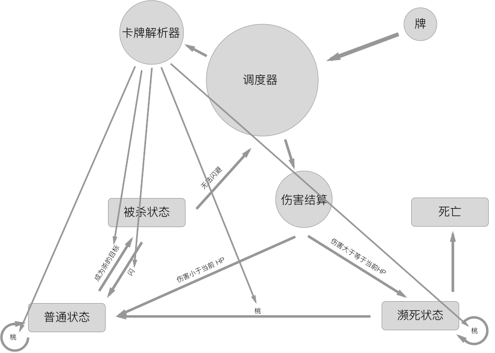

# irc-sha

a sha-like game played in irc

## 快速开始

```bash
python -m venv .venv && source .venv/bin/activate
pip install -e '.[dev]'

pytest                 # 跑测试
python example.py      # 自动演示一局
python -m isha.game.cli 甲 乙 丙 丁 戊   # 本地热座对战（5 或 8 人）
python -m isha.game.web                # Web 热座前端：http://127.0.0.1:8000
```

## docker usage

First, build image:
```
docker build -t irc-sha .
```
then, run it:
```
docker run -it --rm irc-sha python
```

## 文档

- 落地路线与架构决策：[docs/ROADMAP.md](docs/ROADMAP.md)
- 2017 版状态流转图（历史设计）：
